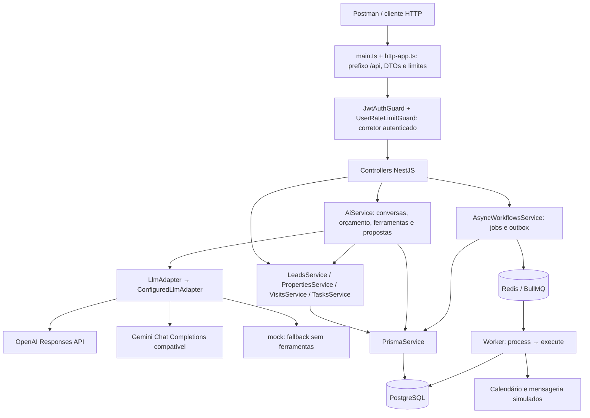
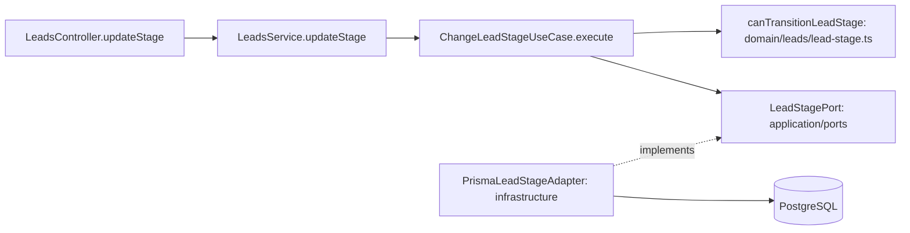
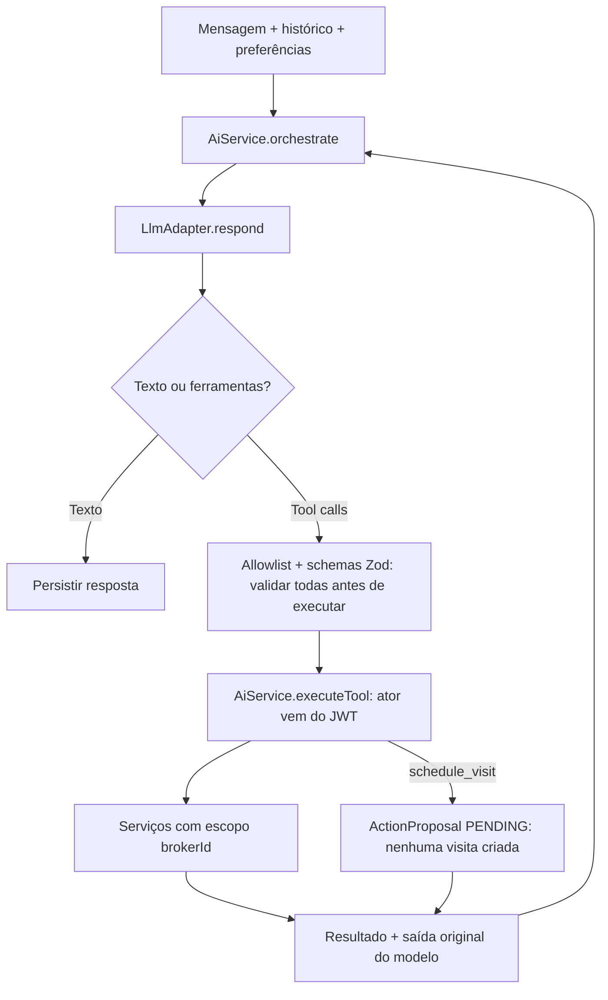
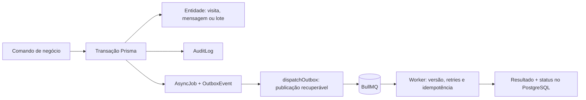

# Arquitetura do código

Este documento descreve a implementação atual da etapa 1. Abra [diagramas.html](diagramas.html) no navegador para uma versão visual sem internet. Os diagramas Mermaid abaixo também podem ser vistos no GitHub ou em um preview Markdown com suporte a Mermaid. Consulte [fluxos de negócio](business-flows.md) e [testes no Postman](postman-testing.md).

## Componentes e execução

`AppModule` conecta os módulos. `main.ts` abre HTTP, exceto com `PROCESS_ROLE=worker`. `AsyncWorkflowsService.onModuleInit` cria a fila e o dispatcher da outbox em todos os papéis; cria o consumidor quando o papel é `all` ou `worker`. O worker pode compartilhar o processo com a API ou rodar separadamente. Calendário e mensageria são simulações no serviço de workflows, ainda sem integração externa real.

## Mapa entre responsabilidades e arquivos

| Responsabilidade | Código principal | Comportamento |
| --- | --- | --- |
| Bootstrap e composição | `src/main.ts`, `src/app.module.ts`, `src/http-app.ts` | Inicialização, módulos, prefixo e proteções HTTP |
| Autenticação | `src/auth/` | Cadastro, login, JWT e ator autenticado |
| CRM e imóveis | `src/leads/`, `src/properties/` | Preferências, interesses, interações, funil e carteira |
| Transição do funil | `src/application/use-cases/change-lead-stage.use-case.ts` | Valida transição e usa porta de persistência |
| Regras puras | `src/domain/leads/lead-stage.ts`, `src/domain/visits/visit-interval.ts` | Transições e intervalo positivo |
| Persistência do funil | `src/infrastructure/prisma-lead-stage.adapter.ts` | Implementa `LeadStagePort`, histórico e concorrência |
| Visitas e tarefas | `src/visits/`, `src/tasks/` | Regras, transações e auditoria |
| Assistente | `src/ai/ai.service.ts` | Histórico, ferramentas permitidas, limites e confirmação |
| Provedores LLM | `src/ai/llm.adapter.ts` | Protocolos OpenAI/Gemini, extração estruturada e retries Gemini 503 |
| Integrações e filas | `src/integrations/async-workflows.service.ts` | Outbox, jobs, importação, follow-up e simulações |
| Banco e restrições | `src/prisma/`, `prisma/schema.prisma`, `prisma/migrations/` | Models, relações, idempotência e exclusão de horários |
| Observabilidade | `src/shared/http/`, `src/audit/audit.ts`, `src/health/` | Logs sanitizados, métricas, auditoria e saúde |

A organização combina módulos por funcionalidade com domínio, aplicação e infraestrutura explícitos no caso de mudança de estágio. Os demais serviços usam Prisma diretamente; não há uma porta de repositório para cada módulo.

## Dependências no funil

## Fronteira entre IA e regras de negócio

A IA não acessa diretamente o banco nem escolhe o corretor. O backend valida argumentos e propriedade dos recursos. Cada retorno do modelo contabiliza tokens de entrada e saída; o limite total acumula todas as chamadas da execução. O prazo de IA inclui consultas, ferramentas e chamadas ao modelo. Gemini HTTP 503 tem até duas novas tentativas dentro desse prazo; essas tentativas não reiniciam ferramentas.

## Persistência e confiabilidade

As entidades são isoladas por `brokerId`; constraints compostas reforçam relações entre recursos do mesmo corretor. Para visitas `SCHEDULED`, a constraint `visits_no_broker_overlap` impede intervalos sobrepostos do mesmo corretor, mesmo em requisições concorrentes. A proposta não reserva horário: a disputa é resolvida ao criar a visita.

Consulte [runbook](operations-runbook.md) para papéis de processo, incidentes, métricas e parâmetros, e [threat model](threat-model.md) para fronteiras de segurança.
