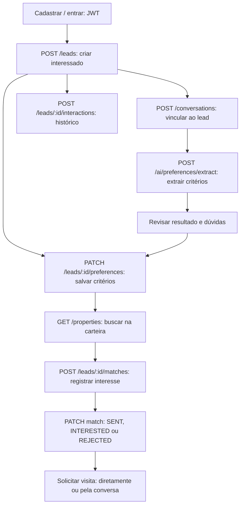
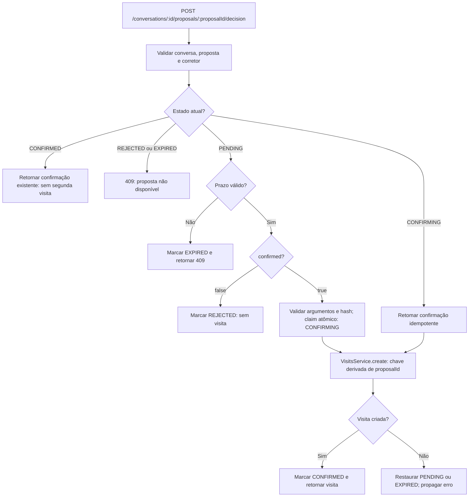
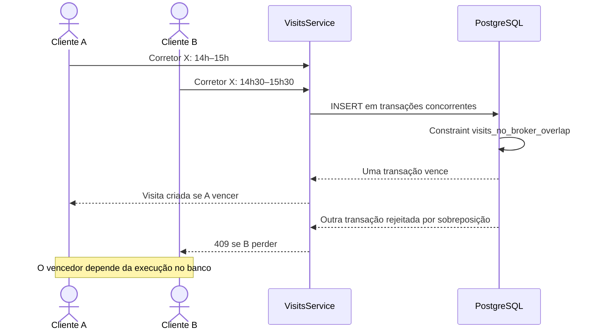
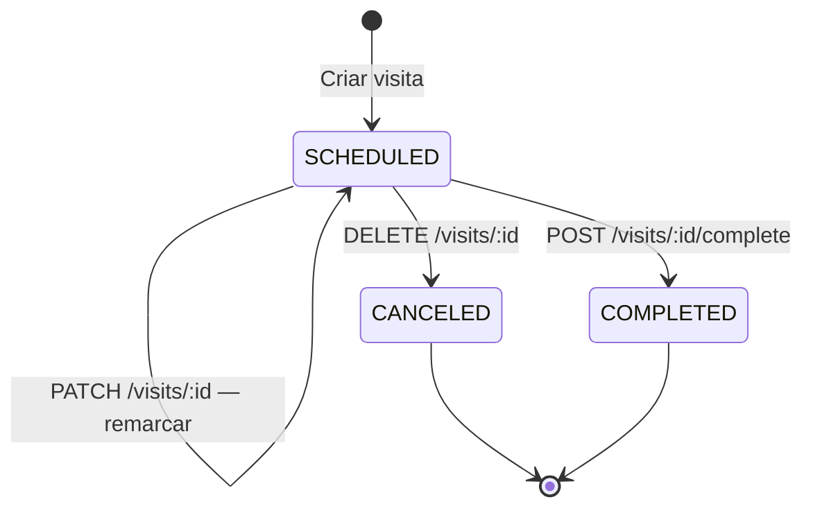
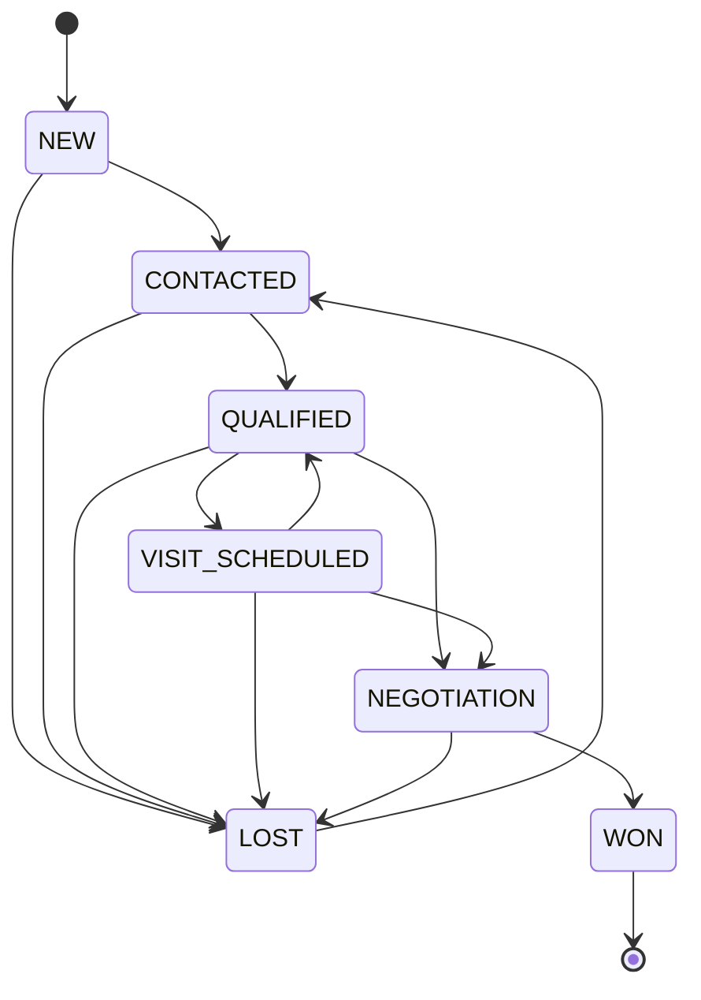
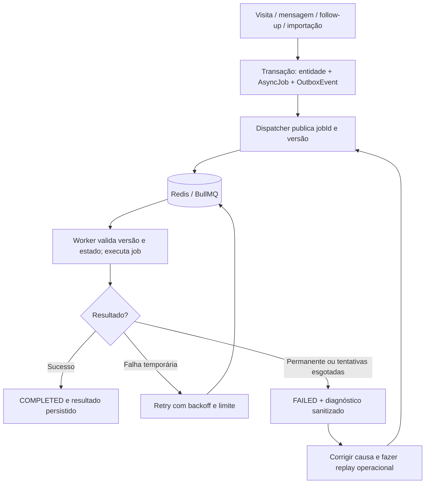

# Fluxos de negócio

Diagramas baseados nos controllers, serviços e regras atuais. Abra [diagramas.html](diagramas.html) para uma versão visual no navegador, sem dependências externas. Veja [arquitetura](architecture.md) e [passo a passo no Postman](postman-testing.md). Os caminhos abaixo omitem `/api`, já incluído em `baseUrl` nos exemplos.

## 1. Atendimento, preferências e imóveis



A extração devolve dados estruturados: não persiste preferências automaticamente. A busca pode ser direta ou por ferramenta da conversa. Ao mudar um match de `REJECTED` para outro status, o motivo armazenado é limpo; enviar um motivo junto com um status diferente de `REJECTED` gera erro de validação.

## 2. Conversa, proposta e falha parcial

```mermaid
sequenceDiagram
  actor User as Corretor / Postman
  participant API as AiController / AiService
  participant Model as LlmAdapter / modelo
  participant DB as PostgreSQL
  User->>API: POST /conversations/:id/messages + Idempotency-Key
  API->>DB: Consultar chave e salvar mensagem do usuário
  API->>Model: Histórico, instruções e ferramentas
  Model-->>API: schedule_visit com imóvel e intervalo
  API->>API: Validar argumentos e acesso ao imóvel
  API->>DB: Persistir proposta PENDING com expiração de 15 min
  Note over API,DB: Proposta não cria visita nem bloqueia horário
  API->>Model: Resultado da ferramenta e histórico completo
  alt Modelo conclui
    Model-->>API: Texto para revisão e confirmação
  else Timeout, limite de tokens ou erro do provedor
    Model-->>API: Falha na continuação
    API->>DB: Registrar orchestrator FAILED com código específico
    API->>API: Informar que há proposta pendente para revisão
  end
  API->>DB: Consultar propostas válidas e salvar resposta
  API-->>User: message + response + proposals
  User->>API: Repetir a mesma Idempotency-Key
  API->>DB: Recuperar mensagens e propostas ainda pendentes
  API-->>User: Resposta salva + proposals atuais; sem reexecutar
```

`proposals` é um campo do retorno de **POST de mensagem**, não da extração nem do histórico de mensagens. Cada item expõe `id`, `actionType`, `summary` e `expiresAt`; use `id` como `proposalId`. São retornadas as propostas pendentes e não expiradas da conversa, inclusive de mensagens anteriores. O texto de uma resposta repetida permanece o originalmente salvo, enquanto a lista de propostas reflete o estado atual.

Quando a IA falha sem proposta disponível, permanece o fallback manual. A indicação de proposta não altera o diagnóstico: métricas e logs continuam registrando a falha. Uma proposta pode ter sido persistida antes de falhar a geração do texto final.

## 3. Decisão explícita e criação da visita



A confirmação é um comando do backend e não chama o modelo. A rejeição de uma proposta pendente não cria visita. Confirmar novamente uma proposta já confirmada retorna o estado existente. O estado `CONFIRMING`, a chave idempotente da visita e a constraint do banco protegem contra duplicação e concorrência. Cancelar uma visita já criada usa o endpoint de visitas, não a decisão da proposta.

## 4. Agenda e disputa do mesmo horário



A proteção vale para **o mesmo corretor**, mesmo com leads ou imóveis diferentes, e para qualquer sobreposição, não apenas horários idênticos. Corretores distintos não compartilham esse bloqueio. Os intervalos são `[início, fim)`: 14h–15h e 15h–16h podem coexistir. Só visitas `SCHEDULED` bloqueiam; propostas não reservam horário. Criar duas propostas compatíveis não garante que ambas poderão ser confirmadas.



Criação gera lembrete e sincronização de calendário pela outbox. Remarcação cancela jobs pendentes antigos e cria novos. Cancelamento cancela jobs pendentes e enfileira atualização de calendário; conclusão cancela jobs pendentes. Essas operações não mudam automaticamente o estágio do lead.

## 5. Funil comercial



Mudanças são explícitas por `PATCH /leads/:id/stage`. O caso de uso valida a regra em `domain/leads/lead-stage.ts`, e o adapter registra histórico e auditoria com proteção contra alterações concorrentes. Reenviar o estágio atual não cria uma transição. `GET /leads/funnel` agrega o funil.

## 6. Jobs, mensagens e importação



| Fluxo | Entrada | Execução e consulta |
| --- | --- | --- |
| Mensagem ao lead | `POST /leads/:id/messages` | `SEND_MESSAGE` usa mensageria simulada; consultar `GET /leads/:id/messages` |
| Lembrete de visita | Criar/remarcar visita | `VISIT_REMINDER` revalida horário e estado, cria mensagem e job `SEND_MESSAGE` sem duplicar |
| Calendário | Visita ou `POST /visits/:id/calendar-sync` | `CALENDAR_SYNC` atualiza evento simulado; consultar `GET /visits/:id/calendar-event` |
| Follow-up | `POST /follow-ups` | `FOLLOW_UP` registra `executedAt` se ainda agendado; conclusão/cancelamento são comandos explícitos |
| Tarefa manual | `POST /tasks` | Persiste tarefa; atualização de status explícita, sem enviar mensagem automaticamente |
| Importação | `POST /imports/properties` | `PROPERTY_IMPORT` valida linhas, faz upsert por corretor/externalKey e gera relatório; consultar `GET /imports/properties/:id` |

Jobs e métricas são consultados em `/operations/jobs` e `/operations/metrics`; replay usa `POST /operations/jobs/:id/replay`. Essas rotas exigem JWT de usuário no papel `OPERATOR`, com permissões `operations:read` para consultas e `operations:replay` para replay. O acesso operacional é global; as rotas normais continuam limitadas ao corretor autenticado. A outbox mantém a intenção no PostgreSQL quando Redis está indisponível; não apague os registros para resolver uma falha.

## 7. Como validar a falha parcial no Postman

1. Envie uma mensagem solicitando proposta, com imóvel existente, datas futuras e uma nova `Idempotency-Key`.
2. Se falhar depois de criar a proposta, a resposta informa que há proposta pendente e inclui `proposals`. O log preserva `AI_TIMEOUT`, `AI_TOKEN_LIMIT` ou outro código.
3. Salve `proposals[0].id`, revise `summary` e confirme ou rejeite. Não é necessário reenviar o pedido de agendamento por causa da falha do modelo.
4. Repita a mensagem com a mesma chave antes da decisão: não deve gerar outra proposta nem executar a IA novamente.
5. Após a decisão, repita a mensagem: o texto salvo continua igual, mas a proposta decidida não deve aparecer em `proposals`.

A latência e a escolha de ferramentas do modelo são variáveis; baixar o orçamento não garante reproduzir uma falha após a proposta. Os testes de `ai.service.spec.ts` simulam essa sequência para timeout e limite de tokens de forma determinística.
